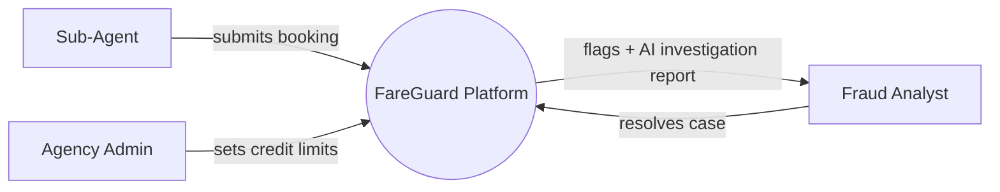

# HLD — System Context (Phase 0)

## Boundary
**FareGuard Platform** — everything inside the box is ours to design; everything outside is an
actor or a stand-in for a system we won't build for real.

## Actors
| Actor | Role |
|---|---|
| **Sub-Agent** (travel agent) | Initiates bookings against their agency's credit line |
| **Agency Admin** | Manages sub-agents and sets/adjusts credit-line limits |
| **Fraud Analyst** | Reviews flagged bookings and reads the AI agent's investigation report, makes the final call |

## Deliberately out of scope (for now)
- A real payment gateway / GDS — bookings are synthetic; no real money or real PNRs.
- Real customer PII — traveler fields are synthetic placeholders.
- Multi-currency settlement — amounts are single-currency to start (keeps Phase 1 focused).

## System context diagram

## Why no external system box
In the real Amadeus system, credit-line data would live in an external ledger service. For this
project, we intentionally own that data ourselves (`CreditLine` entity, see
[02-domain-model.md](02-domain-model.md)) to keep the system self-contained and fully runnable
offline — nothing in FareGuard calls out to a third party. This is a deliberate scope decision,
not an oversight.
