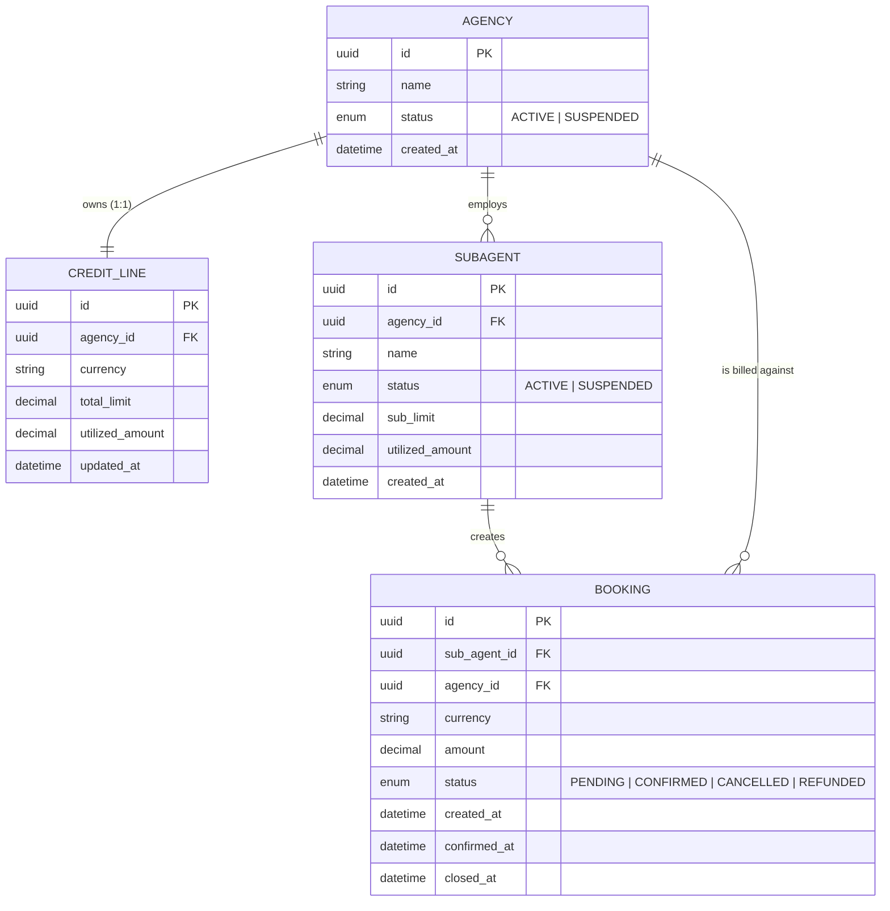
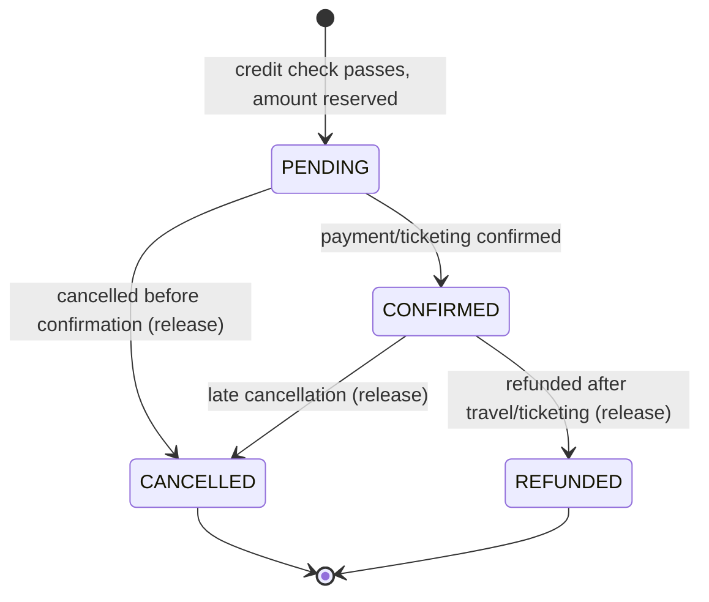

# HLD — Domain Model (Phase 0)

## Scope
Four entities for the MVP: `Agency`, `SubAgent`, `CreditLine`, `Booking`. `FraudCase` is
deliberately **not modeled yet** — it's introduced in Phase 1 (rules engine flags) and fleshed out
in Phase 4 (AI investigation agent).

## Entity relationship diagram

## Why two layers of limit (Agency pool + SubAgent sub-limit)
This is the core shape being mirrored from the real problem: a **sub-agent** can abuse credit
even when the parent **agency** has room left, if nobody checks the sub-agent's own allocation.
So every booking must pass **both** checks:
1. `SubAgent.utilized_amount + booking.amount <= SubAgent.sub_limit`
2. `CreditLine.utilized_amount + booking.amount <= CreditLine.total_limit`

Admins are allowed to over-allocate sub-limits across sub-agents (sum of sub-limits can exceed
the agency total) — that over-allocation gap is itself a realistic fraud-risk signal for later
phases, not a bug.

## Utilization tracking: running balance, reserved at creation
`utilized_amount` on both `CreditLine` and `SubAgent` is a **running balance**, not recomputed
from scratch each time. It changes at exactly two points in the booking lifecycle:
- **+amount** when a `Booking` is created in `PENDING` (the credit is reserved immediately, before
  confirmation — this is what "real-time credit-line blocking" means: the check + reservation
  happen atomically at booking time, so two concurrent bookings can't both slip through on the
  same remaining headroom).
- **-amount** when a `Booking` moves to `CANCELLED` or `REFUNDED` (the reservation is released).

`CONFIRMED` does not change utilization — the amount stays committed from `PENDING` through
`CONFIRMED` since the money is still "on the line" either way.

## Booking status lifecycle

A `Booking` is only ever created in `PENDING` — if either credit check fails, no `Booking` row is
created at all (the rules engine rejects the request before it becomes a record). This keeps the
entity itself a clean audit trail of only ever-attempted-and-allowed bookings; outright-rejected
attempts are a separate concern (logged as rejected requests, not modeled as entities here).

## Fields deliberately left out of Phase 0
- No traveler/PII fields on `Booking` (synthetic placeholder fields come with the data generator,
  not the schema itself).
- No multi-currency conversion — `currency` is stored per `CreditLine`/`Booking` but no FX logic
  exists yet (out of scope per [01-system-context.md](01-system-context.md)).
- No `FraudCase` entity — comes with the rules engine (Phase 1) and AI agent (Phase 4).

## Open questions carried into Phase 1 LLD
- Exact precision/type for money fields (likely fixed-point integer minor-units in the actual
  schema, not `decimal`/`float`, to avoid rounding bugs) — to be nailed down in the Phase 1 LLD
  when the C++ rules engine's data types are decided.
- Whether `SubAgent.sub_limit` is admin-set per sub-agent at creation or defaults to some
  fraction of the agency pool — a synthetic-data-generator concern, decided when that generator
  is built later in this phase.
