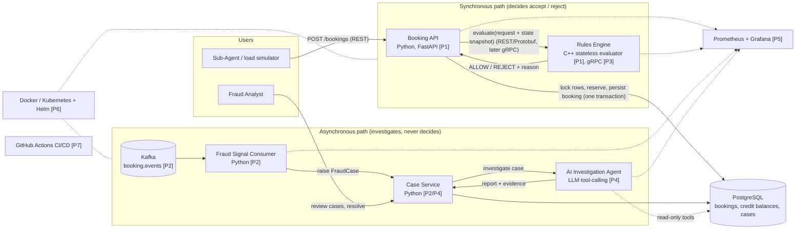
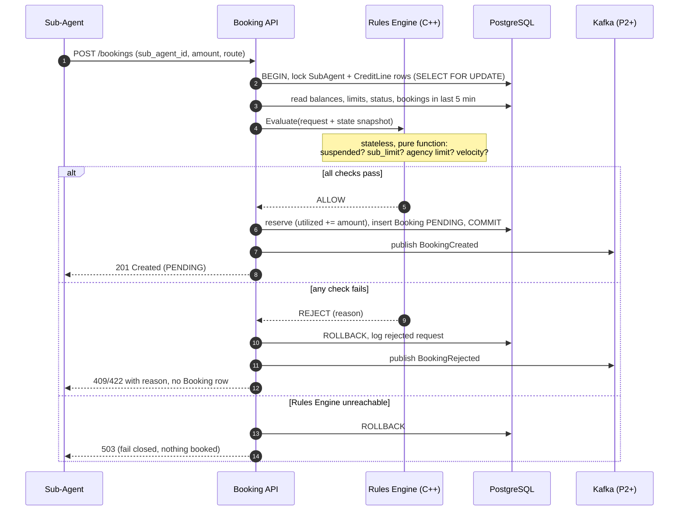
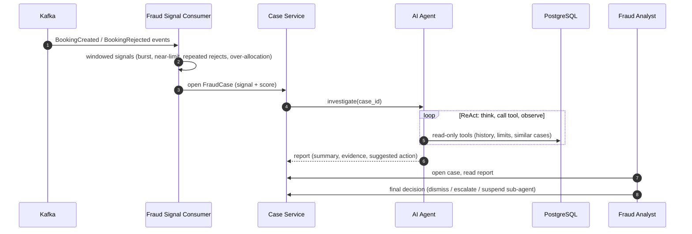

# HLD — System Architecture (end-state, all phases)

This is the "map" for the whole project. Each phase adds boxes to it; nothing here is built yet
except the synthetic data generator (Phase 0). Context for who uses the system is in
[01-system-context.md](01-system-context.md); entities are in [02-domain-model.md](02-domain-model.md).

## 1. Component diagram (end state)
Labels in brackets show the phase that introduces each piece.

Solid arrows are data/control flow; dotted arrows are metrics scraping, read-only access or
deployment relationships.

## 2. Flow A: booking request (synchronous, the "real-time credit-line blocking" path)

The row locks serialize concurrent bookings for the same sub-agent/agency, so two requests can't
both spend the same remaining headroom. Later transitions (`CONFIRMED`, `CANCELLED`, `REFUNDED`)
go through the same API; cancel/refund decrements the balances in one transaction (no engine call
needed, since releasing credit can't violate a limit).

## 3. Flow B: fraud signal and AI investigation (asynchronous, never blocks Flow A)

## 4. Responsibility split (the safety-first rule)
| Component | Owns | Must NOT |
|---|---|---|
| Rules Engine | The accept/reject verdict (deterministic, stateless: same input gives same output) | Hold state, touch the DB, call an LLM, depend on Kafka or the agent |
| Booking API | Booking records, credit balances (transactional reserve/release), HTTP contract | Make credit decisions itself |
| Fraud Consumer | Turning event streams into signals/cases | Block or alter a booking |
| AI Agent | Investigation and explanation, via read-only tools | Approve/reject bookings or write credit state |
| Fraud Analyst (human) | Final action on a case (including suspending a sub-agent) | n/a |

Why: the money-affecting decision stays deterministic, auditable and fast (PCI-DSS/SDL mindset);
the probabilistic LLM only adds explanation on a path that can fail without hurting bookings.

## 5. What exists after each phase
| After phase | Running pieces | New arrows |
|---|---|---|
| 0 (done) | Synthetic data generator | files in `data/generated/` |
| 1 | Booking API + Rules Engine + DB | Flow A, over REST/Protobuf; generator replays traffic through the API |
| 2 | + Kafka, Fraud Consumer, Case Service | Flow B up to "case opened" |
| 3 | same | API to Rules Engine becomes gRPC |
| 4 | + AI Agent | Flow B complete |
| 5 | + Prometheus, Grafana | metrics from every service |
| 6 | all of the above in kind/minikube via Helm | deployment |
| 7 | CI pipeline around everything | build/test/scan on each push |
| 8 | optional case-review UI | analyst-facing screen |

## 6. Decisions made for Phase 1 (2026-10-20)
| Question | Decision | Consequence |
|---|---|---|
| Who owns credit balances? | **Database.** The API does a transactional check + reserve; the C++ engine is a stateless pure function | Atomicity comes from row locks in PostgreSQL, not from the engine. Engine is trivially testable and horizontally scalable. Tradeoff: row locks are held during the engine call (fine locally; keep it fast and set a lock/call timeout) |
| Database | **PostgreSQL in Docker Compose from day one** | Same engine used later in Kubernetes; real `SELECT ... FOR UPDATE` semantics |
| Velocity rule | **Reject when a sub-agent already has 10 bookings created in the last 5 minutes** (the 11th is refused, reason `VELOCITY_EXCEEDED`) | Needs an index on `(sub_agent_id, created_at)`. The generator's bursts (15-30 bookings in minutes) will be cut off at 10 when replayed through the API; slower or sub-threshold bursts are left for the Phase 2 fraud consumer to catch |
| Rules Engine down | **Fail closed**: roll back, return 503, nothing booked | Never "allow by default" |

Note: the Phase 0 generator does not apply the velocity rule (it only models limits and
suspension), so its accepted-booking data contains full bursts. That is intentional training data
for the fraud pipeline; replaying it through the Phase 1 API will reject the excess.

## 7. Still to settle in the Phase 1 LLD
- Rules Engine API contract (Protobuf messages for the request + state snapshot + verdict) and how
  the C++ service is exposed over REST in Phase 1 before gRPC arrives in Phase 3.
- Table schemas and indexes; money as `BIGINT` minor units.
- Idempotency: a client retry of `POST /bookings` must not double-reserve (idempotency key).
- Rejected-request logging table (mirrors the generator's `rejected_requests`).
