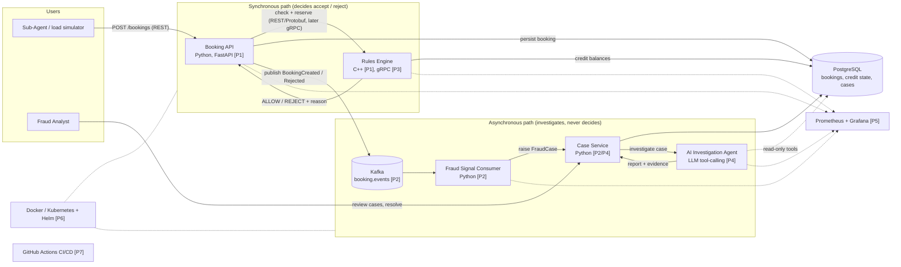
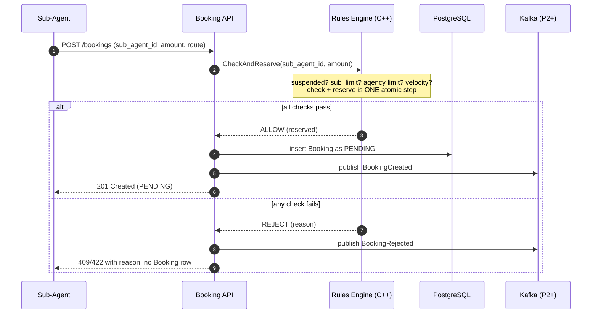
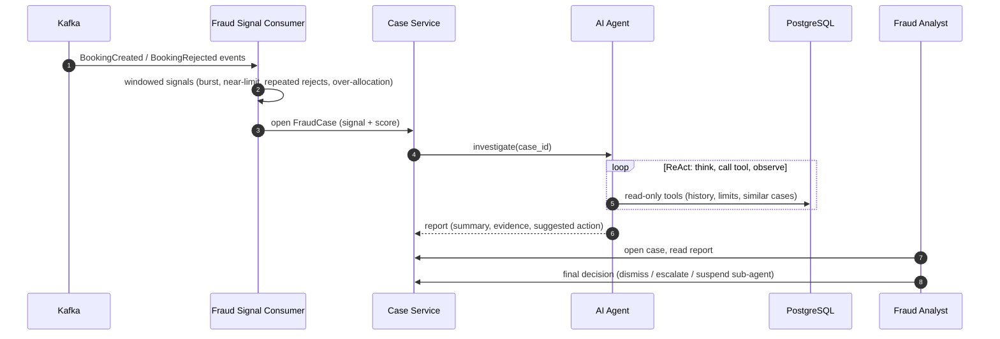

# HLD — System Architecture (end-state, all phases)

This is the "map" for the whole project. Each phase adds boxes to it; nothing here is built yet
except the synthetic data generator (Phase 0). Context for who uses the system is in
[01-system-context.md](01-system-context.md); entities are in [02-domain-model.md](02-domain-model.md).

## 1. Component diagram (end state)
Labels in brackets show the phase that introduces each piece.

Solid arrows are data/control flow; dotted arrows are metrics scraping, read-only access or
deployment relationships.

## 2. Flow A: booking request (synchronous, the "real-time credit-line blocking" path)

Later transitions (`CONFIRMED`, `CANCELLED`, `REFUNDED`) go through the same API; cancel/refund
calls the Rules Engine to **release** the reservation.

## 3. Flow B: fraud signal and AI investigation (asynchronous, never blocks Flow A)

## 4. Responsibility split (the safety-first rule)
| Component | Owns | Must NOT |
|---|---|---|
| Rules Engine | The accept/reject decision and credit reservation (deterministic) | Call an LLM, depend on Kafka or the agent |
| Booking API | Booking records and lifecycle, HTTP contract | Make credit decisions itself |
| Fraud Consumer | Turning event streams into signals/cases | Block or alter a booking |
| AI Agent | Investigation and explanation, via read-only tools | Approve/reject bookings or write credit state |
| Fraud Analyst (human) | Final action on a case (including suspending a sub-agent) | n/a |

Why: the money-affecting decision stays deterministic, auditable and fast (PCI-DSS/SDL mindset);
the probabilistic LLM only adds explanation on a path that can fail without hurting bookings.

## 5. What exists after each phase
| After phase | Running pieces | New arrows |
|---|---|---|
| 0 (done) | Synthetic data generator | files in `data/generated/` |
| 1 | Booking API + Rules Engine + DB | Flow A, over REST/Protobuf; generator replays traffic through the API |
| 2 | + Kafka, Fraud Consumer, Case Service | Flow B up to "case opened" |
| 3 | same | API to Rules Engine becomes gRPC |
| 4 | + AI Agent | Flow B complete |
| 5 | + Prometheus, Grafana | metrics from every service |
| 6 | all of the above in kind/minikube via Helm | deployment |
| 7 | CI pipeline around everything | build/test/scan on each push |
| 8 | optional case-review UI | analyst-facing screen |

## 6. Design questions to settle in the Phase 1 HLD
1. **Who owns credit balances?** Proposal: the Rules Engine is the single writer of
   `utilized_amount` (in-memory per-agency state, persisted to PostgreSQL), which gives atomic
   check+reserve without distributed locking. Alternative: balances live only in the DB and the
   API does a transactional check+reserve, making the C++ engine a pure function.
2. **Velocity checks**: what window and threshold (e.g. N bookings per sub-agent per minute)?
3. **Failure behavior**: if the Rules Engine is down, the API fails closed (reject with 503), never
   "allow by default".
4. **Database for Phase 1**: PostgreSQL in Docker Compose from the start, or SQLite first?
